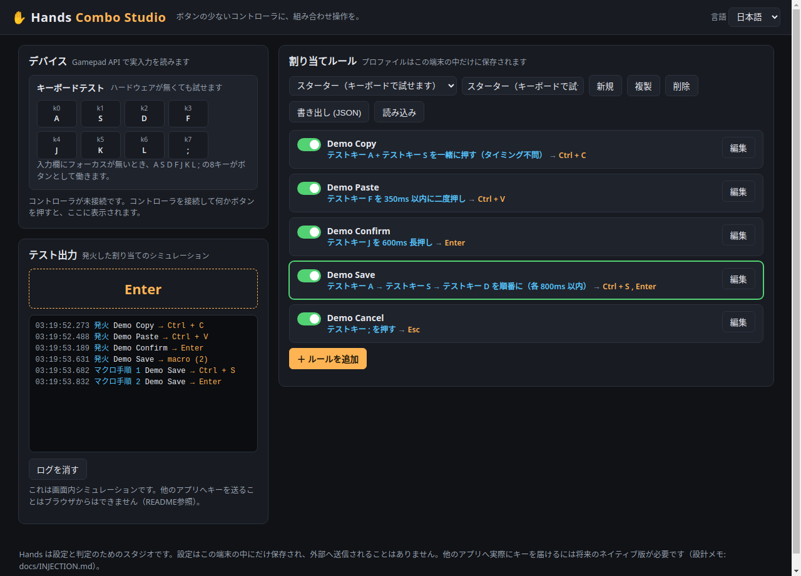

# Hands — Combo Studio

**Combos for controllers that are short on buttons.**

Hands is a configuration studio for button-poor controllers such as the
Meta Quest 3 Touch controllers. Like a keyboard customization tool, it lets
you assign key presses and macros to **button combinations** — simultaneous
presses, long presses, double presses and ordered sequences — far beyond
the handful of physical buttons the device has. You design the bindings
against your real controller, watch them fire live, and keep the result as
a portable profile file.

日本語: ボタンの少ないコントローラ（Quest 3 の Touch コントローラ等）のための
「組み合わせ設定スタジオ」です。同時押し・長押し・二度押し・順番押しに
キー入力やマクロを割り当て、実機入力でその場で発火を確認できます。
設定は端末内だけに保存され、JSON や共有リンク（URL のフラグメントに埋め込むため、サーバーへは送られません）で持ち運べます。



## Get it — the desktop app (official form)

Hands is distributed as **desktop software**. The desktop app is the
official, supported form: download the build for your OS from the
[Releases](https://github.com/shizukutanaka/Hands/releases) page.

| OS | File | How to run |
|---|---|---|
| Windows | `Hands-<version>-win-x64.exe` (portable) | Run the exe; no installer |
| macOS | `Hands-<version>-mac-<arch>.zip` | Unzip and open `Hands.app` |
| Linux | `Hands-<version>-linux-x86_64.AppImage` | `chmod +x` it, then run it |

**The builds are not code-signed.** Windows SmartScreen ("Windows
protected your PC") and macOS Gatekeeper ("cannot be opened because the
developer cannot be verified") may warn you or block the first launch.
On Windows choose *More info → Run anyway*; on macOS right-click
`Hands.app` → *Open* (or allow it under System Settings → Privacy &
Security). Only do this for files downloaded from this repository's
Releases page.

The desktop app is a thin, locked-down Electron shell around the same
`index.html` (renderer sandboxed, no Node.js in the page, no preload,
new windows and navigation away from the app blocked; `http(s)` links
open in your default browser). It still makes no network requests.

日本語: Hands は**デスクトップアプリ（ソフトウェア）が正規の配布形態**です。
Releases から OS 別のファイルを入手してください。ビルドは**未署名**のため、
Windows の SmartScreen や macOS の Gatekeeper が初回起動時に警告・ブロックする
ことがあります（Windows は「詳細情報 → 実行」、macOS は右クリック →「開く」）。

### Running the page directly

No install, no build, no account: `index.html` also still opens in a
browser (Chrome / Edge recommended for the Gamepad API), or serve the
folder with any static file server. Everything runs locally; the page
makes no network requests at all.

## What you can do

- **Live device monitor** — every connected gamepad appears with its
  buttons lighting up as you press them, including analog trigger values.
  Button-name presets are included for Quest 3 Touch (left/right) and
  standard gamepads, and you can switch the naming per device.
- **Five trigger kinds**
  - *Press* — a plain button press.
  - *Chord* — several buttons together. The simultaneity window is
    adjustable; set it to 0 for modifier style (hold one button, tap
    another — like Ctrl+C).
  - *Long press* — hold a button (or a combination) for a set time.
  - *Double press* — tap the same button twice within an interval.
  - *Sequence* — press buttons in a set order, each step within a time
    limit.
- **Actions** — a key or key combination (e.g. `Ctrl+Shift+P`), or a
  *macro*: an ordered list of key steps with per-step delays.
- **Learn mode** — instead of picking buttons from a list, press the
  actual combination on your controller and Hands records it. Action keys
  can likewise be captured from your physical keyboard.
- **Profiles** — create, duplicate, rename and switch profiles. Stored in
  the browser on this device only; export/import as JSON to move them
  between machines, or share one as a link: the profile is encoded in the
  link's URL fragment, which is never sent to a server, and opening the
  link imports it as a new profile.
- **No hardware?** Eight keyboard keys (A S D F J K L ;) act as test
  buttons, and the built-in starter profile demonstrates every trigger
  kind with them. You can evaluate the whole studio before connecting
  anything.
- **Interface languages**: Japanese and English.

## Honest scope — what Hands does *not* do

A web page **cannot send keystrokes to other applications**. Browsers
deliberately forbid it. So in this web version, fired bindings are shown
in the built-in test-output panel (a simulation), and the real deliverable
is the **verified profile**: the bindings you designed and proved against
your own inputs.

Delivering those keys to games and apps requires a native companion that
reads the same profile files and injects input at OS level. A **minimal
Windows version now exists** in [companion/](companion/README.md): it
polls XInput controllers, runs the same detection engine (parity with
this page's core is proven by generated test vectors), and sends keys
with `SendInput`. It builds with the compiler that ships with Windows —
nothing to install. It has **not yet been verified on a real Windows
machine**; the check procedure is in its README. Linux and macOS
companions remain design-only; the design memo — platform APIs,
pitfalls, and security rules — is in
[docs/INJECTION.md](docs/INJECTION.md). The profile format and the
detection semantics are shared, so nothing you configure today is
throwaway work.

## Detection semantics (the exact rules)

All boundaries are inclusive; the engine is deterministic and test-driven.

| Trigger | Fires when |
|---|---|
| Press | the button's press edge occurs |
| Chord | all members are down and (window = 0, or the spread between first and last member press ≤ window). Latches until a member is released |
| Long press | all members have been continuously down for the hold time, counted from when the set completed. Releasing early cancels |
| Double press | the second press edge lands within the interval of the first (press-to-press). After firing, the next press starts a new pair |
| Sequence | members are pressed in order, each step within the per-step window of the previous matched step. A wrong button resets progress (pressing the first member restarts) |

Rules are independent: one input can fire several rules, and every firing
is shown in the output log.

## Privacy

Settings live in your browser's local storage on your device. Hands has
no server, no analytics and no network access — the page's Content
Security Policy forbids it (`connect-src 'none'`). See
[PRIVACY.md](PRIVACY.md) and [SECURITY.md](SECURITY.md).

## Development

Zero dependencies; the whole app is the single file `index.html`
(the detection engine is the delimited `HANDS CORE` section inside it).

```sh
# Core engine tests (plain Node, no install)
node tests/run-tests.js

# UI test in Electron (needs an Electron binary + Xvfb on Linux)
xvfb-run -a <electron-binary> tests/ui-main.js --no-sandbox
```

Desktop shell (`desktop/main.js`; `electron` and `electron-builder` are
pinned dev dependencies with a committed `package-lock.json` — the app
itself stays dependency-free):

```sh
npm ci
npm start        # run the desktop app from source
npm run dist     # build for the current OS into dist/
                 # (Windows: portable exe, macOS: zip, Linux: AppImage)
```

CI runs the core tests plus checks that the app stays single-file and
free of external references. The Windows companion in `companion/` has
its own tests (logic + parity vectors against this core) and its own CI
workflow; see its README.

## License

MIT — see [LICENSE](LICENSE).
